
<a href="README.md">Deutsch</a> · <b>English</b>

  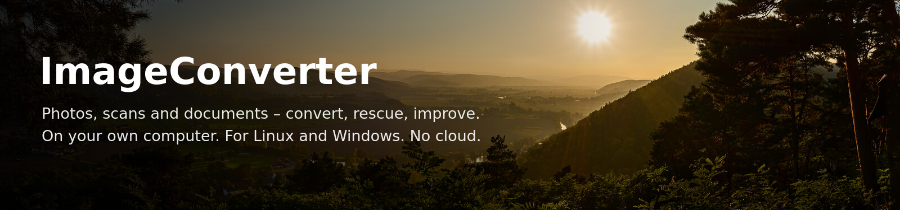

  
  
  
  
  
  
  

<h3 align="center">One image program for all the quick jobs of everyday life.</h3>

  Convert, shrink, straighten, erase, remove haze, print – in one window, on your own computer. 
  No account. No cloud. No subscription.

---

## Made for everyday life

The phone photo is too big for the email. The book page is curved, the receipt crumpled, the scan crooked. There is a watermark on
the holiday picture, haze hangs over the valley, and the old family photo is barely bigger than a postage stamp. There is a tool for
each of these somewhere – ImageConverter brings them together in one window. And no image ever leaves your computer.

- **Opens whatever comes along:** 35 file extensions – JPEG, PNG, HEIC from the iPhone, WebP, AVIF, JPEG XL, PSD, SVG and the RAW
  files of common cameras. What counts is the content, not the extension: even a wrongly named image opens.
- **Saves what fits:** WebP, PNG, JPEG, AVIF, JPEG XL, TIFF, BMP and ICO; the file size is shown before you save.
- **Straighten out:** curved sheets and book pages, crooked scans, tilted horizons, the perspective of signs and boards.
- **Erase:** paint over watermarks, lettering or people – the AI fills the spot to match its surroundings.
- **Cut out:** separate the subject from the background automatically, make the background transparent or blurred.
- **Enlarge and rescue:** enlarge old, small or noisy photos with AI, restore faces.
- **Image editing with a fine touch:** haze, light, colour, white balance, noise, grain – computed in 32-bit floating point.
- **Many images at once:** the same settings for all or individual settings for each image, file names from a pattern, never
  overwritten.
- **Print:** several photos economically on one page, with cutting marks – or straight to PDF.
- **And on the side:** view, measure and even edit STL and 3MF models for 3D printing.

---

## Haze gone, depth back

  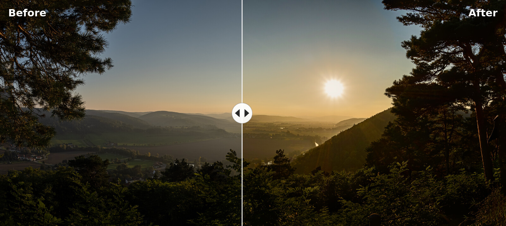

Shot against the low evening sun, almost 8,000 pixels wide – and a grey veil over the whole valley. After the dehaze filter the
landscape is back: green meadows, ranges of hills layered one behind the other, colours as you saw them on the spot. Sky and sun
stay calm, because the filter recognises them and leaves them in peace – no streaks in the sky, no bright halos around the trees.
In the program you simply drag the dividing line back and forth with the mouse.

Best viewed large – a click on the pictures opens them. Look at the valley on the left: where everything was veiled in grey a moment
ago, the meadows are green again, the field brown and the roofs red. The whole panorama is computed in about ten seconds.

  <a href="docs/bilder/readme/en/dehaze-before.jpg">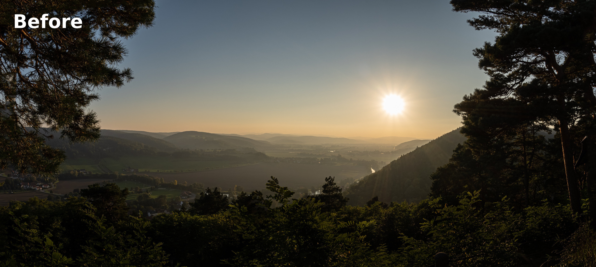</a>
  <a href="docs/bilder/readme/en/dehaze-after.jpg">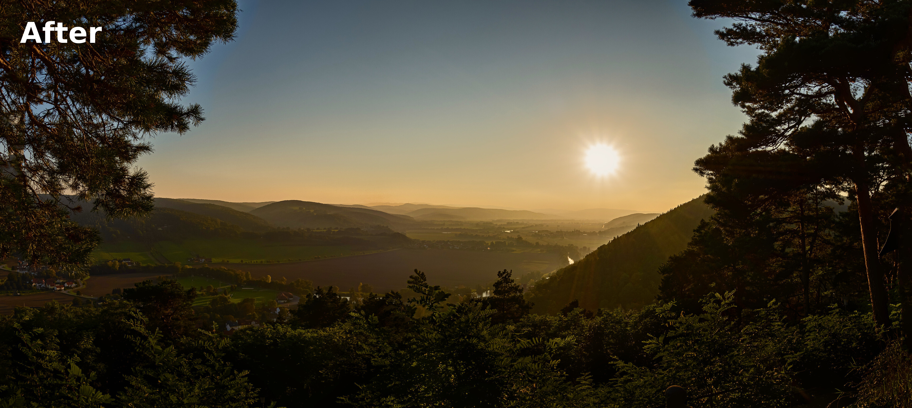</a>

- **Gentle, not brute force:** the haze disappears in several careful passes – look, estimate again, continue. More passes act
  more strongly and still look natural.
- **Finely adjustable:** eight sliders from clarity and sharpness to haze colour – for exactly the mood you have in mind.
- **Backlight without worry:** sky, sun and soft gradients stay protected.

<b>The settings of this example</b>

| Group | Setting |
|---|---|
| Dehaze | Strength +42, 8 passes, clarity 53 %, contrast 12 %, vibrance 25 %, fine sharpen 60 %, brightness 85 %, deband 50 %, haze colour 50 % |
| Match colour | Luminance 117 %, target 48 %, threshold 20 %, colour +30 |
| Luminosity mask | Strength +19 %, fade out 75 %, gradient 30 |
| Light | Contrast +10, shadows +8, highlights −100 |
| Colour | Vibrance +19, saturation −12 |

---

## Straighten out what is crooked

  
  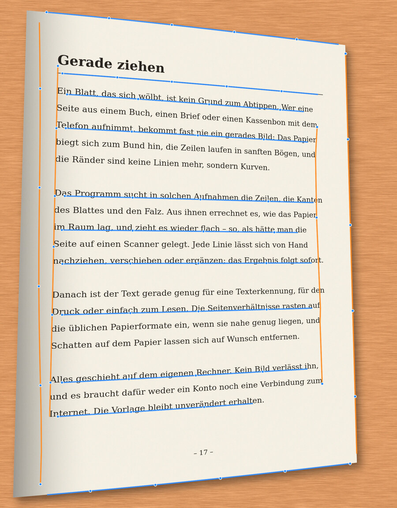
  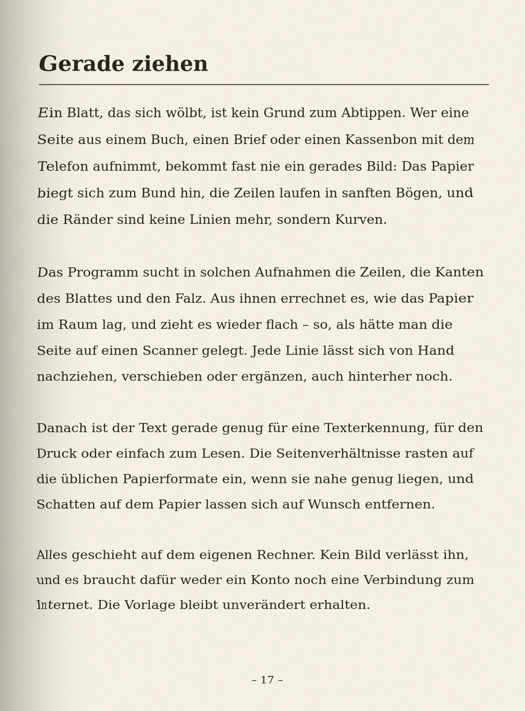

Quickly taken with the phone, at an angle from above, and the page curves towards the spine – the lines run in arcs. ImageConverter
finds lines of text, edges and margins by itself (middle) and flattens the page from them. On the right the result, cropped to the
page: straight lines, right angles, flat as from a scanner. If a line does not sit quite right, drag it into place with the mouse –
even afterwards.

- **Curved page:** set lines along text lines and margins or have them suggested – a sheet model flattens the page and snaps to
  standard paper sizes. Double pages with a fold, too.
- **AI straightening:** one click for crumpled sheets, receipts and book pages; shadows on the paper disappear along the way.
- **Straighten perspective:** place four corners on something that is rectangular in reality – a sign, a board, a painting – with a
  magnifier for the exact point.
- **Level the tilt:** rotate freely in steps of 0.1°, plus 90° steps and mirroring.
- **Crop:** a frame with eight handles, fixed aspect ratios from 1:1 to 16:9, rounded corners up to a circle with a transparent edge.

## Erase and cut out

  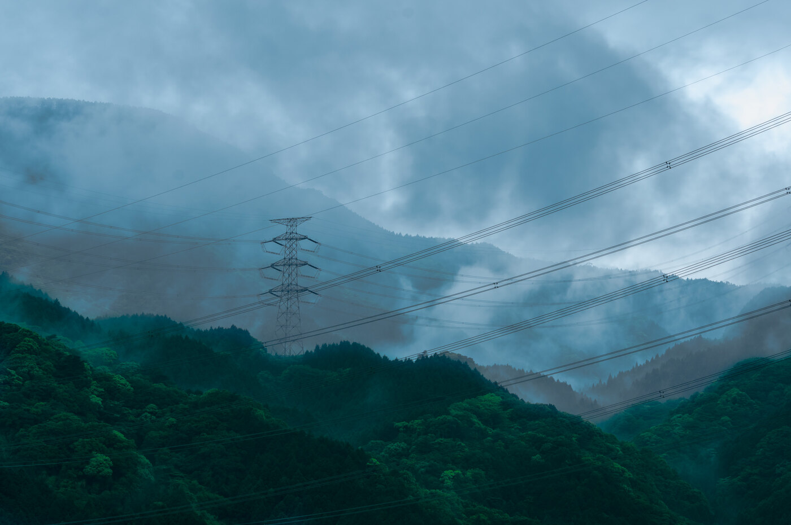
  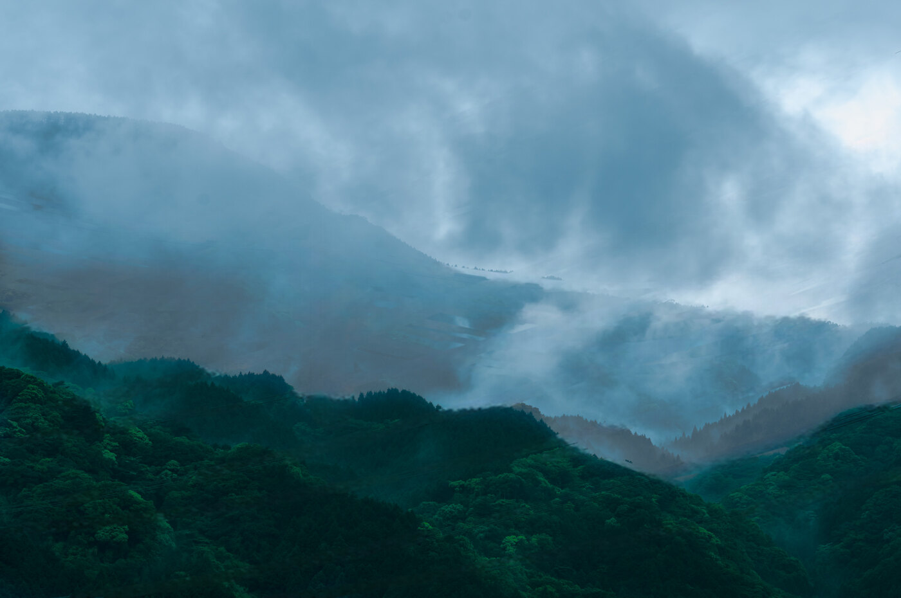

**Pylon gone, power lines gone.** Paint over them once, “Remove” – and the AI puts in what ought to be behind them: clouds, wisps of
fog, treetops. A second short pass takes care of the last fine remains. Everything outside the marking stays untouched, pixel for
pixel.

  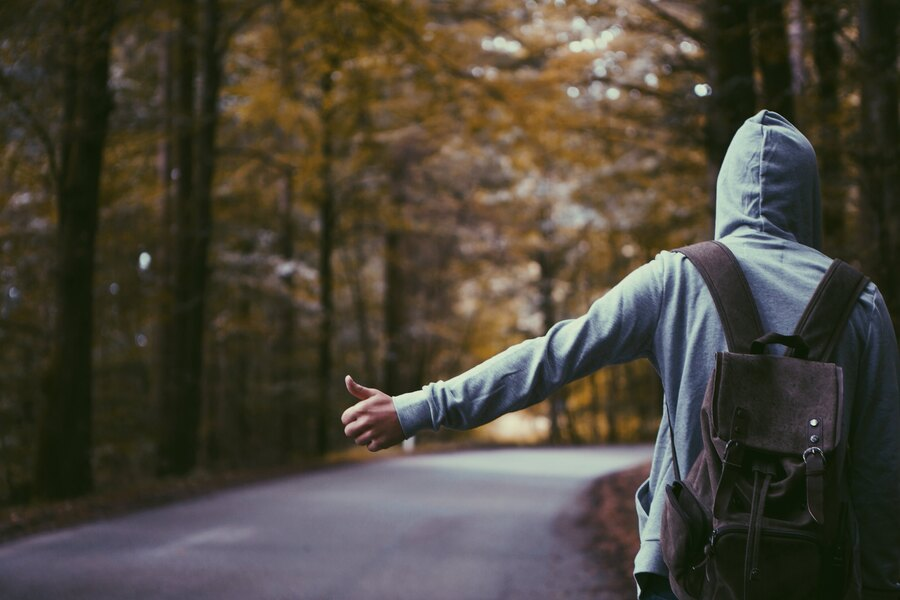
  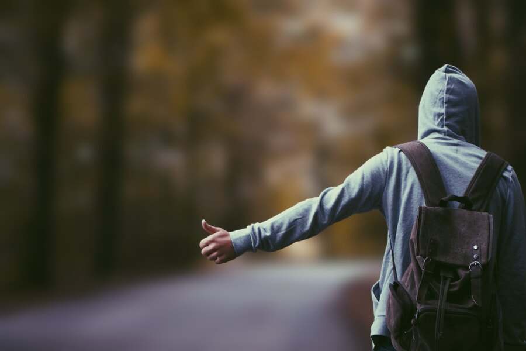
  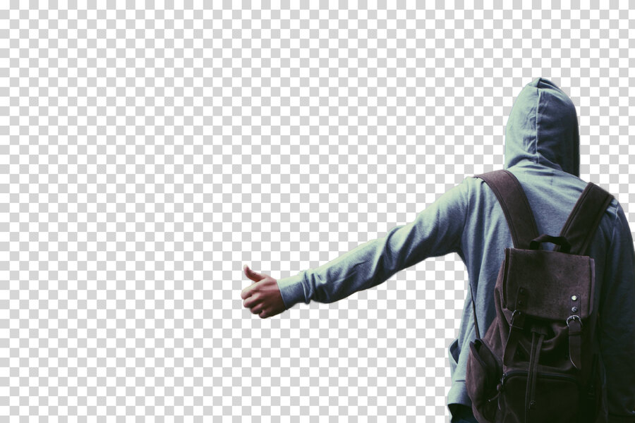

**Cut out with one click.** ImageConverter finds the person including the hood, the backpack and the outstretched thumb. Then the
choice is yours: let the forest melt away softly as with a wide-open aperture (middle) or remove it completely and save a PNG with
a transparent background (right, shown on a checkerboard).

Photos: Altas Green and Charles Devaux via Unsplash, public domain (CC0).

- **Remove:** paint over whatever is in the way with the brush. Two models are ready – one thorough, one fast.
- **Background:** cut out the subject automatically, touch up with the brush (red = away, green = stays), background transparent or
  blurred like a portrait with a wide-open aperture. Three models for people, products and fine hair.

## Enlarge and rescue faces

- **Three AI upscalers** from the fast all-rounder to the thorough diffusion model, each to the exact target size.
- **Fidelity slider:** scaled back down, the result gives the original again – nothing is invented that was not there.
- **Restore faces** with four models; afterwards adjustable live: strength, skin texture, wrinkles, grain.
- **An honest remaining time** with the clock time, cancellable at any moment; if you like, only the visible section as a trial.

## Image editing

The groups act in a fixed, sensible order – each can be switched off and on again with the eye in the list of edits, and with
**Before / After** you can see at any time what has changed.

| Group | What it does |
|---|---|
| **Sharpen** | radius and strength |
| **Noise** | luminance and colour noise, matched to the measured noise of the photo |
| **Dehaze** | see above – several passes, sky protected |
| **White balance** | eyedroppers for neutral, black and white |
| **Match colour** | brighten dark areas selectively, neutralise a colour cast, cooler or warmer |
| **Luminosity mask** | limit the effect to bright or dark areas, show the mask |
| **Light** | brightness, contrast, shadows, highlights – edge-aware, without halos |
| **Colour** | vibrance, saturation, tint (sepia, for example) |
| **Grain** | film grain with size, roughness, colour share and hardness – measured from the photo if you like |

Undo and redo for every single step (Ctrl+Z / Ctrl+Y).

## Many images, one click

- **Open a folder or drag images into the window,** browse with the arrow keys, F11 for full screen.
- **The same settings for all** – or individual settings for each image.
- **Export** with progress; errors of single images are collected instead of cancelling everything.
- **File names from a pattern** with `{name}`, `{breite}` (width), `{höhe}` (height), `{n}`, `{datum}` (date) – existing files are
  never overwritten.
- **Metadata and colour:** keep or remove EXIF, IPTC and XMP or delete only the location; keep the colour profile or convert to sRGB.
  All image information clearly arranged by camera, shot, location and author.

## Print

- **Several images per page** – easy to cut, as dense as possible or one image per page, with cutting marks.
- **ISO, US and photo sizes,** rotated automatically, with a page preview.
- **Save as PDF** with exact dimensions.

## View, measure and edit 3D models

  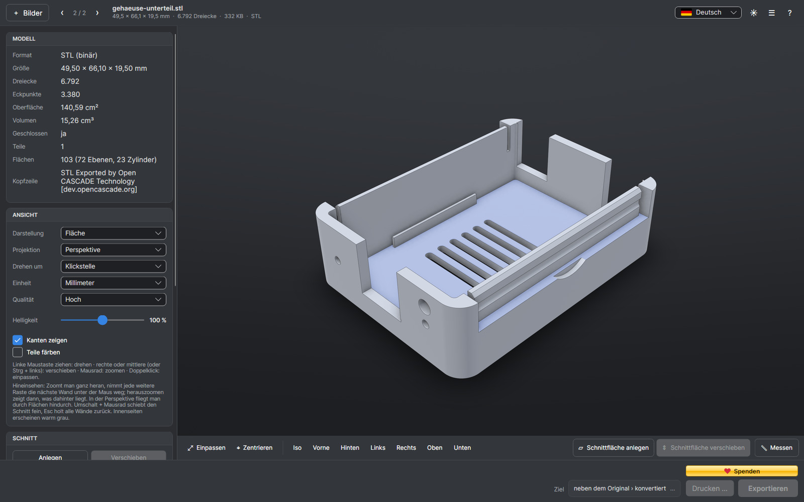

The lower part of a housing for 3D printing, as the viewer shows it at quality level “High”: smooth curves, soft shadows in corners
and holes, edges as fine lines. On the left the key figures are ready – dimensions, surface area, volume, whether the model is
closed, and 103 recognised faces, among them 23 cylinders. Two clicks on two faces, and you know whether the part fits inside.

  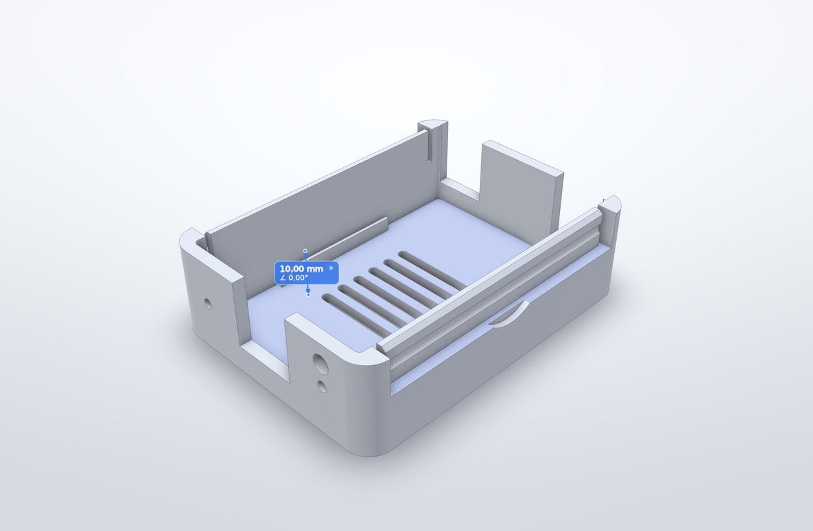
  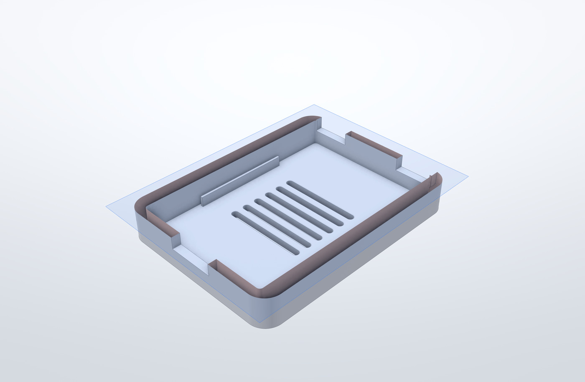

- **View STL and 3MF:** up to 20 million triangles; shown as solid, wireframe or blueprint, parts in colour, perspective or
  parallel; up to six section planes that can be moved finely with the mouse wheel.
- **Measure:** click two faces – distance and angle; cylinder diameter; point to point with ΔX/ΔY/ΔZ.
- **Edit:** change lengths, add and subtract boxes or cylinders, move faces, draw shapes and extrude or cut them out – with
  snapping and dimensions, 30 steps of undo, saving as STL.

<b>What makes the viewer special</b>

- **Nothing looks rounder than it is.** Only faces that the viewer itself has recognised as a cylinder or a curved surface are drawn
  smoothly, and only where the file is divided finely enough. A cylinder gets the exact direction of its surface, planes stay flat,
  edges sharp. Coarsely divided parts appear as faceted as they are in the file.
- **Light that shows shapes.** A matt material, a main light from the upper left, a gentle fill light and ambient occlusion that
  softly darkens corners, holes and transitions – equally good for a small screw and a large housing. Underneath, a soft shadow on
  the ground.
- **Clean edges.** Up to eightfold anti-aliasing, and a fine dither prevents banding in long colour gradients. On Linux, the edge
  lines also fade out softly and sit exactly on the edge, and section edges are smoothed too.
- **Fast even with large files.** An STL model with 5 million triangles is read in 0.4 seconds and is on screen at once; face
  recognition then takes 1.6 seconds, a measuring click about two millionths of a second. Drawing only happens when something
  changes – your computer stays quiet.
- **Measured on the file, not on the picture.** The viewer computes every dimension from the triangles of the file in double
  precision. It recognises planes, cylinders and curved surfaces by itself, even in STL files that know nothing about them.
- **Careful with files from elsewhere.** Files from the internet are read with fixed limits, so that a damaged or manipulated file
  cannot paralyse the program.
- **Built independently.** The rendering talks to the graphics card directly through OpenGL, without an additional 3D library – on
  Linux and Windows.

---

## Your computer, your images

- **No telemetry,** no usage data, no account. ImageConverter only goes online when you download an AI model.
- **AI local only:** all models run on your computer. They are not included but downloaded at the push of a button – with a
  checksum, into a folder next to the program.
- **The graphics card is used:** filters such as dehaze and denoise via OpenCL or CUDA, AI on Windows via DirectX 12 on any common
  card. A built-in speed test picks whichever is faster.
- **No installation:** an AppImage on Linux, a single `.exe` on Windows. If you like, a script creates the menu entry and “Open with”
  – without administrator rights.
- **German and English** built in; further languages as a simple text file.

---

## Download and run

The current version is under [Releases](../../releases):

| System | File | Run |
|---|---|---|
| **Linux** (x86_64) | `ImageConverter-<version>-linux-x64.tar.gz` | unpack, start `ImageConverter-x86_64.AppImage`; `einrichten.sh` adds it to the menu |
| **Windows** (x64) | `ImageConverter-<version>-windows-x64.zip` | unpack, start `ImageConverter.exe`; `einrichten.ps1` sets up “Open with” |

The AI features download their model on first use through the download manager in the settings.

**Build it yourself:** .NET 10 SDK, then `./publish.sh beides` (Linux) or `publish.ps1` (Windows).

---

## Licence

ImageConverter is **free of charge** – for everyone, companies included. The source code is openly visible; you may use, share and
change it. Only **selling** it is not allowed: the licence is MIT with the Commons Clause ([LICENSE](LICENSE)). This is deliberately
“source available” and not open source in the sense of the OSI.

**AI models** have their own licences. Two of them are free for non-commercial use only (CodeFormer, 4x-UltraSharpV2); the model
list in the program shows the licence of every model. All components with version and licence:
[THIRD-PARTY-NOTICES.md](THIRD-PARTY-NOTICES.md).

**Liability and warranty:** ImageConverter is provided free of charge and without warranty (“as is”). The author is liable only for
intent and gross negligence, for injury to life, body or health and under the German Product Liability Act; any further liability is
excluded, in particular for data loss and consequential damage. The German wording in [LICENSE](LICENSE) is binding. Please keep your
originals – ImageConverter always saves to a new file anyway.

Developed with AI assistance – every feature measured and backed by more than 550 tests.

