

  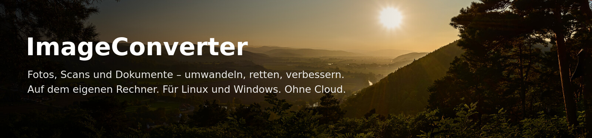

  
  
  
  
  
  
  

<h3 align="center">Ein Bildprogramm für alles, was man im Alltag mal schnell braucht.</h3>

  Umwandeln, verkleinern, begradigen, wegradieren, Dunst entfernen, drucken – in einem Fenster, auf Ihrem Rechner. 
  Ohne Konto. Ohne Cloud. Ohne Abo.

---

## Für den Alltag gebaut

Das Handyfoto ist zu groß für die Mail. Die Buchseite ist gewölbt, der Kassenbon zerknittert, der Scan schief. Auf dem Urlaubsbild
prangt ein Wasserzeichen, über dem Tal hängt Dunst, und das alte Familienfoto ist kaum größer als eine Briefmarke. Für all das gibt
es irgendwo ein Werkzeug – ImageConverter hat sie in einem Fenster versammelt. Und kein Bild verlässt dabei Ihren Rechner.

- **Öffnen, was kommt:** 35 Dateiendungen – JPEG, PNG, HEIC vom iPhone, WebP, AVIF, JPEG XL, PSD, SVG und RAW-Dateien der gängigen
  Kameras. Entscheidend ist der Inhalt, nicht die Endung: Auch ein falsch benanntes Bild öffnet.
- **Speichern, was passt:** WebP, PNG, JPEG, AVIF, JPEG XL, TIFF, BMP und ICO; die Dateigröße steht schon vor dem Speichern da.
- **Gerade ziehen:** gewölbte Blätter und Buchseiten, schiefe Scans, schräge Horizonte, Perspektive von Schildern und Tafeln.
- **Wegradieren:** Wasserzeichen, Schrift oder Personen übermalen – die KI füllt die Stelle passend zur Umgebung.
- **Freistellen:** Motiv automatisch vom Hintergrund lösen, Hintergrund durchsichtig oder unscharf.
- **Vergrößern und retten:** alte, kleine oder verrauschte Fotos mit KI vergrößern, Gesichter wiederherstellen.
- **Bildbearbeitung mit Feingefühl:** Dunst, Licht, Farbe, Weißabgleich, Rauschen, Körnung – gerechnet in 32-Bit-Fließkomma.
- **Viele Bilder auf einmal:** gleiche Einstellungen für alle oder für jedes Bild eigene, Dateinamen nach Muster, nie überschrieben.
- **Drucken:** mehrere Fotos sparsam auf eine Seite, mit Schnittmarken – oder gleich als PDF.
- **Und nebenbei:** STL- und 3MF-Modelle für den 3D-Druck ansehen, messen und sogar bearbeiten.

---

## Dunst weg, Tiefe zurück

  

Gegen die tief stehende Sonne fotografiert, fast 8 000 Pixel breit – und über dem ganzen Tal ein grauer Schleier. Nach dem
Dunstfilter ist die Landschaft wieder da: grüne Wiesen, Hügelketten, die sich hintereinander staffeln, Farben, wie man sie vor Ort
gesehen hat. Himmel und Sonne bleiben dabei ruhig, denn der Filter erkennt sie und lässt sie in Frieden – keine Streifen im Himmel,
keine hellen Säume um die Bäume. Im Programm schieben Sie die Trennlinie einfach mit der Maus hin und her.

Am schönsten in groß – ein Klick auf die Bilder öffnet sie. Schauen Sie ins Tal links: Wo eben noch alles grau verschleiert war,
sind die Wiesen wieder grün, der Acker braun und die Dächer rot. Das ganze Panorama ist in rund zehn Sekunden gerechnet.

  <a href="docs/bilder/readme/dunst-vorher.jpg">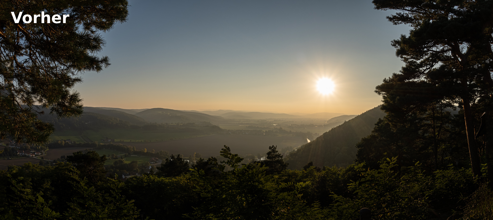</a>
  <a href="docs/bilder/readme/dunst-nachher.jpg">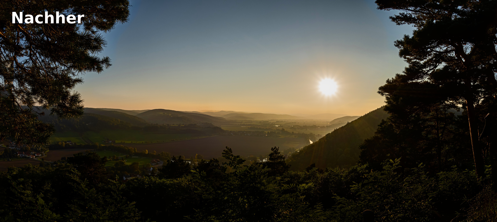</a>

- **Behutsam statt brachial:** Der Dunst verschwindet in mehreren sachten Durchläufen – ansehen, neu schätzen, weiter. Mehr
  Durchläufe wirken kräftiger und bleiben trotzdem natürlich.
- **Fein abstimmbar:** acht Regler von Klarheit über Schärfe bis Dunstfarbe – für genau die Stimmung, die Sie im Kopf haben.
- **Gegenlicht ohne Sorge:** Himmel, Sonne und weiche Verläufe bleiben geschützt.

<b>Die Einstellungen dieses Beispiels</b>

| Gruppe | Einstellung |
|---|---|
| Dunst | Stärke +42, 8 Durchläufe, Klarheit 53 %, Kontrast 12 %, Dynamik 25 %, Schärfe fein 60 %, Helligkeit 85 %, Entstufen 50 %, Dunstfarbe 50 % |
| Gleiche Farbe | Luminanz 117 %, Zielwert 48 %, Schwellwert 20 %, Farbe +30 |
| Luminanzmaske | Stärke +19 %, Auslaufen 75 %, Verlauf 30 |
| Licht | Kontrast +10, Tiefen +8, Lichter −100 |
| Farbe | Dynamik +19, Sättigung −12 |

---

## Gerade ziehen, was schief ist

  
  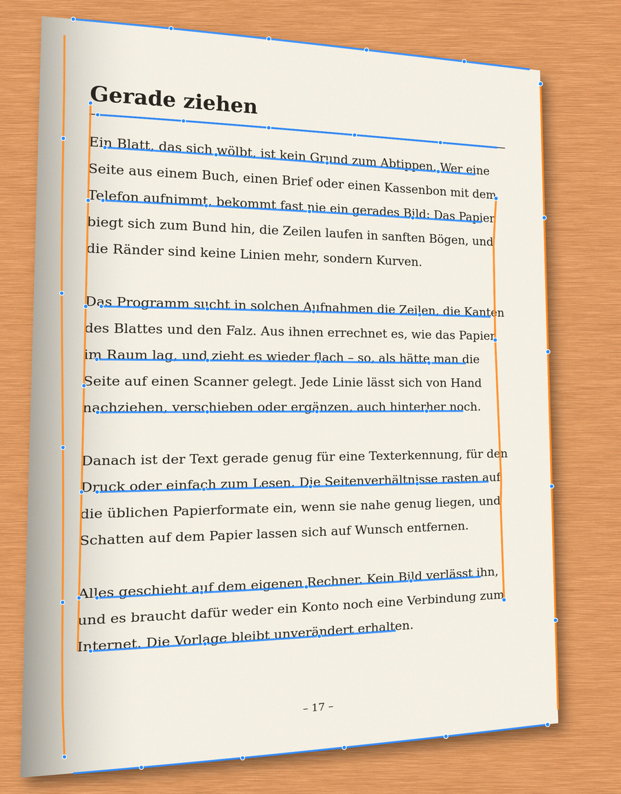
  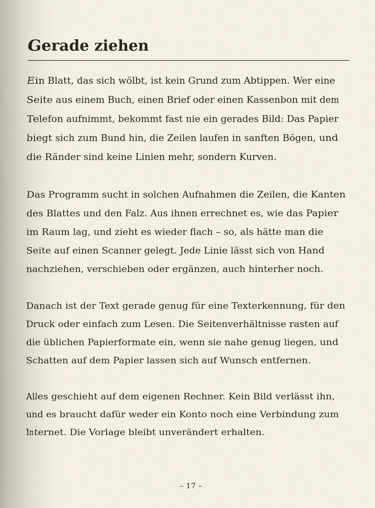

Schnell mit dem Handy fotografiert, schräg von oben, und die Seite wölbt sich zum Bund – die Zeilen laufen in Bögen. ImageConverter
findet Textzeilen, Kanten und Ränder von selbst (Mitte) und zieht die Seite daraus glatt. Rechts das Ergebnis, auf die Seite
zugeschnitten: gerade Zeilen, rechte Winkel, flach wie vom Scanner. Sitzt eine Linie nicht ganz, ziehen Sie sie mit der Maus
zurecht – auch hinterher noch.

- **Gewölbtes Blatt:** Linien an Textzeilen und Rändern setzen oder vorschlagen lassen – ein Blattmodell zieht die Seite glatt und rastet
  auf DIN-Formate ein. Auch Doppelseiten mit Falz.
- **KI begradigen:** ein Klick für zerknitterte Blätter, Kassenbons und Buchseiten; Schatten auf dem Papier verschwinden gleich mit.
- **Perspektive entzerren:** vier Ecken auf etwas legen, das in Wirklichkeit rechteckig ist – Schild, Tafel, Gemälde – mit Lupe für den
  genauen Punkt.
- **Schräglage ausgleichen:** frei drehen in Schritten von 0,1°, dazu 90°-Schritte und Spiegeln.
- **Zuschneiden:** Rahmen mit acht Griffen, feste Seitenverhältnisse von 1:1 bis 16:9, runde Ecken bis zum Kreis mit durchsichtigem
  Rand.

## Wegradieren und freistellen

  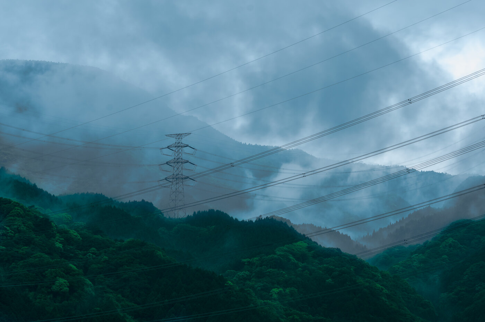
  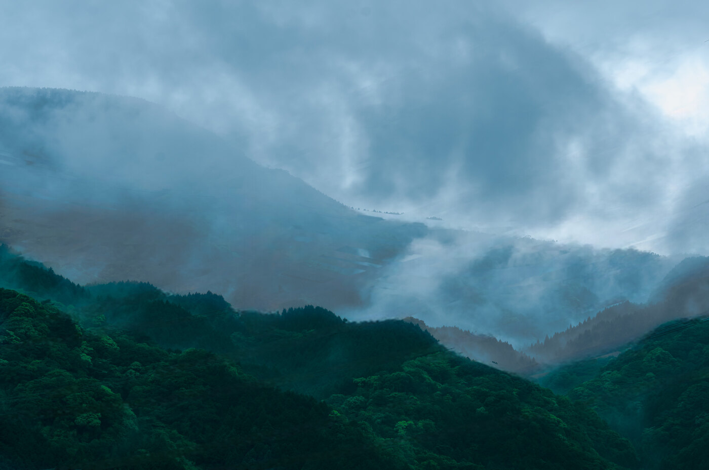

**Strommast weg, Leitungen weg.** Einmal drübermalen, „Entfernen“ – und die KI setzt ein, was dahinter sein müsste: Wolken,
Nebelschwaden, Baumkronen. Ein zweiter kurzer Durchgang nimmt die letzten feinen Reste mit. Alles außerhalb der Markierung bleibt
Pixel für Pixel unangetastet.

  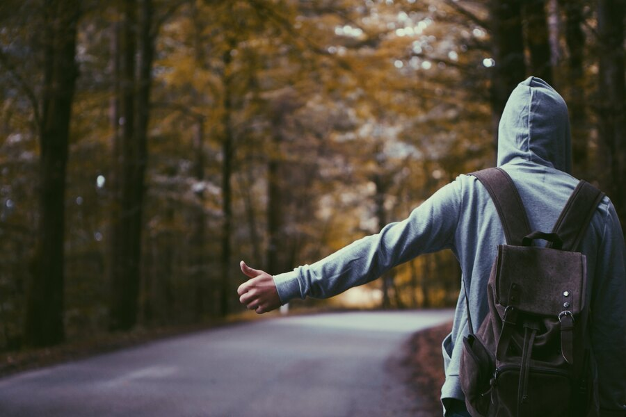
  
  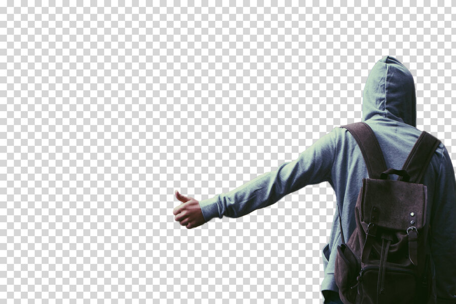

**Freistellen mit einem Klick.** ImageConverter findet die Person samt Kapuze, Rucksack und ausgestrecktem Daumen. Dann haben Sie
die Wahl: den Wald weich verschwimmen lassen wie bei offener Blende (Mitte) oder ganz entfernen und als PNG mit durchsichtigem
Hintergrund speichern (rechts, hier auf Schachbrett).

Fotos: Altas Green und Charles Devaux über Unsplash, gemeinfrei (CC0).

- **Entfernen:** mit dem Pinsel über das Störende malen. Zwei Modelle stehen bereit – eines gründlich, eines schnell.
- **Hintergrund:** Motiv automatisch freistellen, mit Pinsel nacharbeiten (rot = weg, grün = bleibt), Hintergrund durchsichtig oder
  unscharf wie beim Porträt mit offener Blende. Drei Modelle für Menschen, Produkte und feine Haare.

## Vergrößern und Gesichter retten

- **Drei KI-Vergrößerer** vom schnellen Allrounder bis zum gründlichen Diffusionsmodell, jeweils auf die genaue Zielgröße.
- **Treue-Regler:** Verkleinert ergibt das Ergebnis wieder das Original – es wird nichts dazuerfunden, was nicht da war.
- **Gesichter wiederherstellen** mit vier Modellen; danach live einstellbar: Stärke, Hautstruktur, Falten, Körnung.
- **Ehrliche Restzeit** mit Uhrzeit, jederzeit abbrechbar; auf Wunsch nur der sichtbare Ausschnitt zur Probe.

## Bildbearbeitung

Die Gruppen wirken in einer festen, sinnvollen Reihenfolge – jede lässt sich in der Liste „Bearbeitungen“ per Auge aus- und wieder
einschalten, und mit **Vorher/Nachher** sehen Sie jederzeit, was sich geändert hat.

| Gruppe | Was sie kann |
|---|---|
| **Schärfen** | Radius und Stärke |
| **Rauschen** | Helligkeits- und Farbrauschen, abgestimmt auf das gemessene Rauschen des Fotos |
| **Dunst** | siehe oben – mehrere Durchläufe, Himmel geschützt |
| **Weißabgleich** | Pipetten für Neutral, Schwarz und Weiß |
| **Gleiche Farbe** | dunkle Bereiche gezielt aufhellen, Farbstich ausgleichen, kühler oder wärmer |
| **Luminanzmaske** | Wirkung auf helle oder dunkle Bereiche beschränken, Maske anzeigen |
| **Licht** | Helligkeit, Kontrast, Tiefen, Lichter – kantentreu, ohne Lichthöfe |
| **Farbe** | Dynamik, Sättigung, Färben (etwa Sepia) |
| **Körnung** | filmisches Korn mit Größe, Rauheit, Farbanteil und Härte – auf Wunsch aus dem Foto ermittelt |

Rückgängig und Wiederholen gibt es für jeden Handgriff (Strg+Z / Strg+Y).

## Viele Bilder, ein Klick

- **Ordner öffnen oder Bilder ins Fenster ziehen,** mit den Pfeiltasten blättern, F11 für Vollbild.
- **Gleiche Einstellungen für alle** – oder für jedes Bild eigene.
- **Exportieren** mit Fortschritt; Fehler einzelner Bilder werden gesammelt, statt alles abzubrechen.
- **Dateinamen nach Muster** mit `{name}`, `{breite}`, `{höhe}`, `{n}`, `{datum}` – vorhandene Dateien werden nie überschrieben.
- **Metadaten und Farbe:** EXIF, IPTC und XMP behalten, entfernen oder nur den Aufnahmeort löschen; Farbprofil behalten oder nach sRGB
  umrechnen. Alle Bildinformationen übersichtlich nach Kamera, Aufnahme, Ort und Urheber.

## Drucken

- **Mehrere Bilder pro Seite** – schneidefreundlich, möglichst dicht oder ein Bild pro Seite, mit Schnittmarken.
- **DIN-, US- und Fotoformate,** automatisch gedreht, mit Seitenvorschau.
- **Als PDF speichern** mit exakten Maßen.

## 3D-Modelle ansehen, messen, ändern

  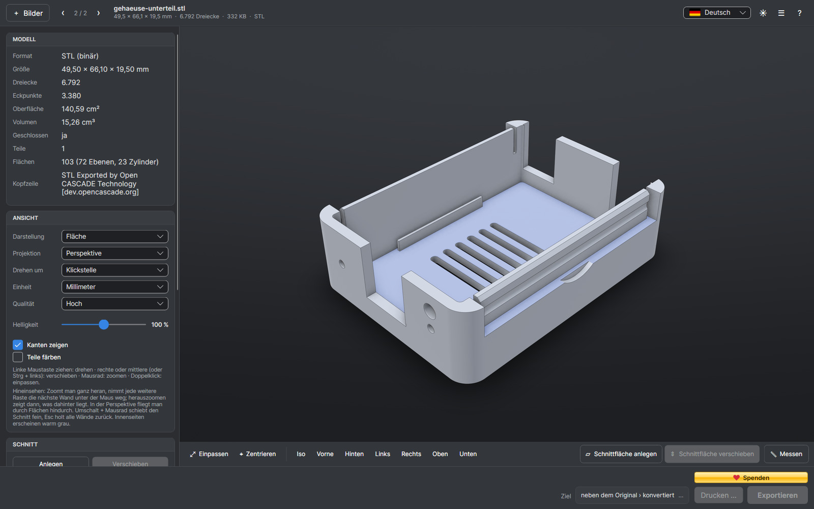

Ein Gehäuse-Unterteil für den 3D-Druck, so wie es der Betrachter in der Qualitätsstufe „Hoch“ zeigt: glatte Rundungen, weiche
Schatten in Ecken und Bohrungen, Kanten als feine Linien. Links stehen die Kennzahlen bereit – Maße, Oberfläche, Volumen, ob das
Modell geschlossen ist, und 103 erkannte Flächen, darunter 23 Zylinder. Zwei Klicks auf zwei Flächen, und Sie wissen, ob das Bauteil
hineinpasst.

  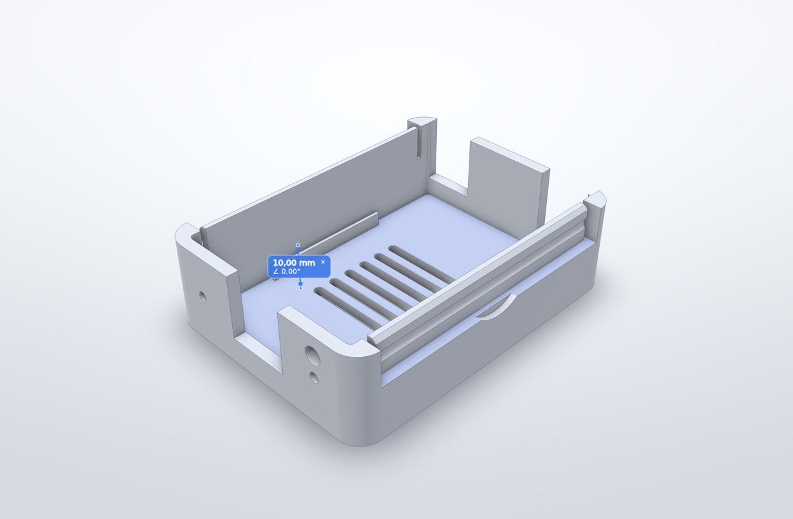
  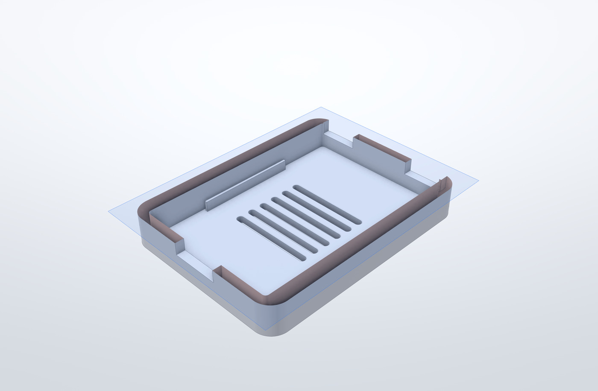

- **STL und 3MF ansehen:** bis 20 Millionen Dreiecke; Darstellung als Fläche, Drahtgitter oder Bauplan, Teile einfärben, Perspektive
  oder parallel; bis zu sechs Schnittebenen, die sich mit dem Mausrad fein verschieben lassen.
- **Messen:** zwei Flächen anklicken – Abstand und Winkel; Zylinderdurchmesser; Punkt zu Punkt mit ΔX/ΔY/ΔZ.
- **Bearbeiten:** Längen ändern, Quader oder Zylinder hinzufügen und wegnehmen, Flächen verschieben, Formen zeichnen und aufbauen oder
  herausschneiden – mit Einrasten und Bemaßung, 30 Schritte rückgängig, Speichern als STL.

<b>Was den Betrachter besonders macht</b>

- **Nichts sieht runder aus, als es ist.** Glatt gezeichnet werden nur Flächen, die der Betrachter selbst als Zylinder oder Rundung
  erkannt hat, und nur dort, wo die Datei fein genug unterteilt ist. Ein Zylinder bekommt die exakte Richtung seiner Oberfläche,
  Ebenen bleiben eben, Kanten scharf. Grob unterteilte Teile erscheinen so kantig, wie sie in der Datei stehen.
- **Licht, das Formen zeigt.** Mattes Material, ein Hauptlicht von links oben, eine sanfte Aufhellung und eine Umgebungsverdeckung,
  die Ecken, Bohrungen und Übergänge weich abdunkelt – gleich gut bei einer kleinen Schraube wie bei einem großen Gehäuse. Darunter
  ein weicher Schatten auf dem Boden.
- **Saubere Kanten.** Bis zu achtfache Kantenglättung, und ein feines Rauschen verhindert Stufen in langen Farbverläufen. Unter Linux
  laufen außerdem die Kantenlinien weich aus und liegen genau auf der Kante, und auch Schnittkanten werden geglättet.
- **Schnell auch bei großen Dateien.** Ein STL-Modell mit 5 Millionen Dreiecken ist in 0,4 Sekunden eingelesen und steht sofort auf dem
  Bildschirm; die Flächenerkennung braucht danach 1,6 Sekunden, ein Messklick etwa zwei Millionstel Sekunden. Gezeichnet wird nur,
  wenn sich etwas ändert – der Rechner bleibt ruhig.
- **Gemessen wird an der Datei, nicht am Bild.** Alle Maße rechnet der Betrachter mit den Dreiecken der Datei in doppelter
  Genauigkeit. Ebenen, Zylinder und Rundungen erkennt er selbst, auch in STL-Dateien, die davon nichts wissen.
- **Vorsichtig mit Fremdem.** Dateien aus dem Netz werden mit festen Grenzen gelesen, damit eine beschädigte oder präparierte Datei
  das Programm nicht lahmlegt.
- **Eigenständig gebaut.** Die Darstellung spricht die Grafikkarte direkt über OpenGL an, ohne zusätzliche 3D-Bibliothek – unter
  Linux und Windows.

---

## Ihr Rechner, Ihre Bilder

- **Keine Telemetrie,** keine Nutzungsdaten, kein Konto. Ins Netz geht ImageConverter nur, wenn Sie ein KI-Modell herunterladen.
- **KI nur lokal:** Alle Modelle rechnen auf Ihrem Rechner. Sie werden nicht mitgeliefert, sondern auf Knopfdruck geladen – mit
  Prüfsumme, in einen Ordner neben dem Programm.
- **Grafikkarte wird genutzt:** Filter wie Dunst und Entrauschen über OpenCL oder CUDA, KI unter Windows über DirectX 12 auf jeder
  gängigen Karte. Ein eingebauter Geschwindigkeitstest wählt das Schnellere.
- **Ohne Installation:** unter Linux als AppImage, unter Windows als einzelne `.exe`. Ein Skript legt auf Wunsch den Menüeintrag und
  „Öffnen mit“ an – ohne Administratorrechte.
- **Deutsch und Englisch** eingebaut; weitere Sprachen als einfache Textdatei.

---

## Herunterladen und starten

Die aktuelle Fassung liegt unter [Releases](../../releases):

| System | Datei | Starten |
|---|---|---|
| **Linux** (x86_64) | `ImageConverter-<Version>-linux-x64.tar.gz` | entpacken, `ImageConverter-x86_64.AppImage` starten; `einrichten.sh` trägt es ins Menü ein |
| **Windows** (x64) | `ImageConverter-<Version>-windows-x64.zip` | entpacken, `ImageConverter.exe` starten; `einrichten.ps1` legt „Öffnen mit“ an |

Die KI-Funktionen laden ihr Modell beim ersten Gebrauch über den Download-Manager in den Einstellungen.

**Selbst bauen:** .NET 10 SDK, dann `./publish.sh beides` (Linux) bzw. `publish.ps1` (Windows).

---

## Lizenz

ImageConverter ist **kostenlos** – für alle, auch für Firmen. Der Quellcode ist offen einsehbar, Sie dürfen ihn nutzen, weitergeben
und verändern. Nur **verkaufen** darf ihn niemand: Die Lizenz ist MIT mit der Commons Clause ([LICENSE](LICENSE)). Das ist bewusst
„Source Available“ und kein Open Source im Sinne der OSI.

**KI-Modelle** haben eigene Lizenzen. Zwei davon sind nur für nicht-kommerzielle Nutzung frei (CodeFormer, 4x-UltraSharpV2);
die Modellliste im Programm zeigt bei jedem Modell seine Lizenz. Alle Bestandteile mit Version und Lizenz: [THIRD-PARTY-NOTICES.md](THIRD-PARTY-NOTICES.md).

**Haftung und Gewährleistung:** ImageConverter wird unentgeltlich und ohne Gewähr („wie es ist“) überlassen. Der Urheber haftet nur für
Vorsatz und grobe Fahrlässigkeit, bei Verletzung von Leben, Körper oder Gesundheit und nach dem Produkthaftungsgesetz; im Übrigen ist
jede Haftung ausgeschlossen, insbesondere für Datenverlust und Folgeschäden. Bitte bewahren Sie Originale auf – ImageConverter
speichert ohnehin immer in eine neue Datei.

Entwickelt mit KI-Unterstützung – jede Funktion gemessen und mit über 550 Tests abgesichert.

