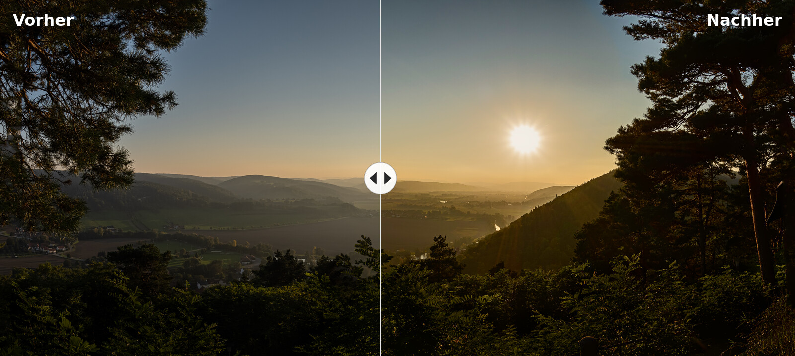
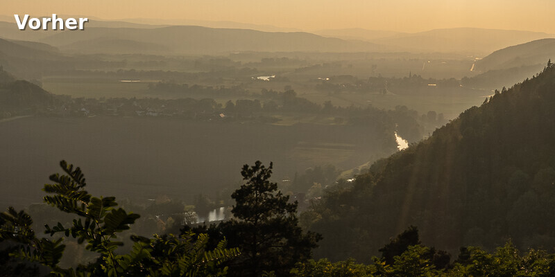
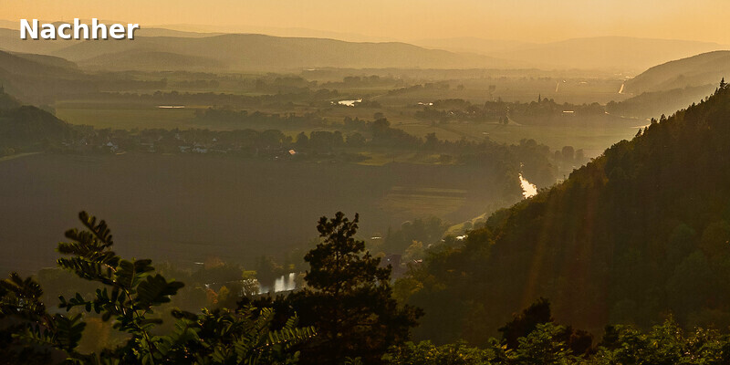

  

  
  
  
  
  
  
  

<h3 align="center">Ein Bildprogramm für alles, was man im Alltag mal schnell braucht.</h3>

  Umwandeln, verkleinern, begradigen, wegradieren, Dunst entfernen, drucken – in einem Fenster, auf Ihrem Rechner. 
  Ohne Konto. Ohne Cloud. Ohne Abo.

---

## Für den Alltag gebaut

Das Foto vom Handy ist zu groß für die Mail. Die Buchseite ist gewölbt fotografiert, der Kassenbon zerknittert, der Scan schief.
Auf dem Urlaubsbild steht ein Wasserzeichen, über dem Tal liegt Dunst, und das alte Familienfoto ist winzig. Für jedes davon gibt es
irgendwo ein Werkzeug – ImageConverter macht all das in einem Programm, ohne dass ein Bild den Rechner verlässt.

- **Öffnen, was kommt:** 35 Dateiendungen – JPEG, PNG, HEIC vom iPhone, WebP, AVIF, JPEG XL, PSD, SVG und RAW-Dateien der gängigen
  Kameras. Entscheidend ist der Inhalt, nicht die Endung: Auch ein falsch benanntes Bild öffnet.
- **Speichern, was passt:** WebP, PNG, JPEG, AVIF, JPEG XL, TIFF, BMP und ICO; die Dateigröße steht schon vor dem Speichern da.
- **Gerade ziehen:** gewölbte Blätter und Buchseiten, schiefe Scans, schräge Horizonte, Perspektive von Schildern und Tafeln.
- **Wegradieren:** Wasserzeichen, Schrift oder Personen übermalen – die KI füllt die Stelle passend zur Umgebung.
- **Freistellen:** Motiv automatisch vom Hintergrund lösen, Hintergrund durchsichtig oder unscharf.
- **Vergrößern und retten:** alte, kleine oder verrauschte Fotos mit KI vergrößern, Gesichter wiederherstellen.
- **Bildbearbeitung mit Feingefühl:** Dunst, Licht, Farbe, Weißabgleich, Rauschen, Körnung – gerechnet in 32-Bit-Fließkomma.
- **Viele Bilder auf einmal:** gleiche Einstellungen für alle oder für jedes Bild eigene, Dateinamen nach Muster, nie überschrieben.
- **Drucken:** mehrere Fotos sparsam auf eine Seite, mit Schnittmarken – oder gleich als PDF.
- **Und nebenbei:** STL- und 3MF-Modelle für den 3D-Druck ansehen, messen und sogar bearbeiten.

---

## Dunst weg, Tiefe zurück

  

**Was Sie sehen:** ein Panorama mit fast 8 000 Pixeln Breite, aufgenommen gegen die tief stehende Sonne. Links das Original, rechts
dasselbe Bild nach dem Dunstfilter – im Programm schieben Sie die Trennlinie mit der Maus hin und her. Das Tal bekommt seine Farben und
seine Staffelung zurück, die Wiesen werden wieder grün, und trotzdem bleiben Himmel und Sonne ruhig: Der Filter erkennt sie und lässt
sie in Frieden – ohne Streifen im Himmel und ohne helle Säume um die Bäume.

  
  

**Im Ausschnitt** wird es deutlich: Dörfer, Felder und der Flusslauf treten aus dem Grau hervor, die fernen Hügelketten lösen sich
voneinander. Das ganze Panorama ist in rund zehn Sekunden gerechnet.

- **Wie das Auge:** Der Dunst wird in mehreren sachten Durchläufen entfernt – ansehen, neu schätzen, weiter. Mehr Durchläufe wirken
  kräftiger, jeder bleibt natürlich.
- **Feinregler** für Klarheit, Kontrast, Dynamik, Schärfe, Kanten, Helligkeit, Entstufen und Dunstfarbe.
- **Himmel und Sonne geschützt,** auch bei Gegenlicht und Verläufen.

<b>Die Einstellungen dieses Beispiels</b>

| Gruppe | Einstellung |
|---|---|
| Dunst | Stärke +36, 8 Durchläufe, Klarheit 42 %, Kontrast 22 %, Dynamik 25 %, Schärfe fein 33 %, Helligkeit 76 %, Entstufen 55 %, Dunstfarbe 51 % |
| Gleiche Farbe | Gesamt 104 %, Luminanz 103 %, Zielwert 45 %, Ausgleichen 18 %, Farbe +4 |
| Luminanzmaske | Stärke +38 %, Auslaufen 75 %, Verlauf 30 |
| Licht | Kontrast +10, Tiefen +14, Lichter −100 |
| Farbe | Dynamik +11 |
| Körnung | Stärke 14 %, Korngröße 1,0 px, Rauheit 30 |

---

## Gerade ziehen, was schief ist

- **Gewölbtes Blatt:** Linien an Textzeilen und Rändern setzen oder vorschlagen lassen – ein Blattmodell zieht die Seite glatt und rastet
  auf DIN-Formate ein. Auch Doppelseiten mit Falz.
- **KI begradigen:** ein Klick für zerknitterte Blätter, Kassenbons und Buchseiten; Schatten auf dem Papier verschwinden gleich mit.
- **Perspektive entzerren:** vier Ecken auf etwas legen, das in Wirklichkeit rechteckig ist – Schild, Tafel, Gemälde – mit Lupe für den
  genauen Punkt.
- **Schräglage ausgleichen:** frei drehen in Schritten von 0,1°, dazu 90°-Schritte und Spiegeln.
- **Zuschneiden:** Rahmen mit acht Griffen, feste Seitenverhältnisse von 1:1 bis 16:9, runde Ecken bis zum Kreis mit durchsichtigem
  Rand.

## Wegradieren und freistellen

- **Entfernen:** mit dem Pinsel über das Störende malen. Zwei Modelle stehen bereit – eines gründlich, eines schnell.
- **Hintergrund:** Motiv automatisch freistellen, mit Pinsel nacharbeiten (rot = weg, grün = bleibt), Hintergrund durchsichtig oder
  unscharf wie beim Porträt mit offener Blende. Fünf Modelle für Menschen, Produkte und feine Haare.

## Vergrößern und Gesichter retten

- **Drei KI-Vergrößerer** vom schnellen Allrounder bis zum gründlichen Diffusionsmodell, jeweils auf die genaue Zielgröße.
- **Treue-Regler:** Verkleinert ergibt das Ergebnis wieder das Original – es wird nichts dazuerfunden, was nicht da war.
- **Gesichter wiederherstellen** mit vier Modellen; danach live einstellbar: Stärke, Hautstruktur, Falten, Körnung.
- **Ehrliche Restzeit** mit Uhrzeit, jederzeit abbrechbar; auf Wunsch nur der sichtbare Ausschnitt zur Probe.

## Bildbearbeitung

Die Gruppen wirken in einer festen, sinnvollen Reihenfolge – jede lässt sich in der Liste „Bearbeitungen“ per Auge aus- und wieder
einschalten, und mit **Vorher/Nachher** sehen Sie jederzeit, was sich geändert hat.

| Gruppe | Was sie kann |
|---|---|
| **Schärfen** | Radius und Stärke |
| **Rauschen** | Helligkeits- und Farbrauschen, abgestimmt auf das gemessene Rauschen des Fotos |
| **Dunst** | siehe oben – mehrere Durchläufe, Himmel geschützt |
| **Weißabgleich** | Pipetten für Neutral, Schwarz und Weiß |
| **Gleiche Farbe** | dunkle Bereiche gezielt aufhellen, Farbstich ausgleichen, kühler oder wärmer |
| **Luminanzmaske** | Wirkung auf helle oder dunkle Bereiche beschränken, Maske anzeigen |
| **Licht** | Helligkeit, Kontrast, Tiefen, Lichter – kantentreu, ohne Lichthöfe |
| **Farbe** | Dynamik, Sättigung, Färben (etwa Sepia) |
| **Körnung** | filmisches Korn mit Größe, Rauheit, Farbanteil und Härte – auf Wunsch aus dem Foto ermittelt |

Rückgängig und Wiederholen gibt es für jeden Handgriff (Strg+Z / Strg+Y).

## Viele Bilder, ein Klick

- **Ordner öffnen oder Bilder ins Fenster ziehen,** mit den Pfeiltasten blättern, F11 für Vollbild.
- **Gleiche Einstellungen für alle** – oder für jedes Bild eigene.
- **Exportieren** mit Fortschritt; Fehler einzelner Bilder werden gesammelt, statt alles abzubrechen.
- **Dateinamen nach Muster** mit `{name}`, `{breite}`, `{höhe}`, `{n}`, `{datum}` – vorhandene Dateien werden nie überschrieben.
- **Metadaten und Farbe:** EXIF, IPTC und XMP behalten, entfernen oder nur den Aufnahmeort löschen; Farbprofil behalten oder nach sRGB
  umrechnen. Alle Bildinformationen übersichtlich nach Kamera, Aufnahme, Ort und Urheber.

## Drucken

- **Mehrere Bilder pro Seite** – schneidefreundlich, möglichst dicht oder ein Bild pro Seite, mit Schnittmarken.
- **DIN-, US- und Fotoformate,** automatisch gedreht, mit Seitenvorschau.
- **Als PDF speichern** mit exakten Maßen.

## 3D-Modelle ansehen, messen, ändern

- **STL und 3MF ansehen:** bis 20 Millionen Dreiecke, glatt dargestellt mit Umgebungsschatten; Maße, Volumen, Oberfläche, ob das Modell
  geschlossen ist; bis zu sechs Schnittebenen.
- **Messen:** Abstand, Winkel, Zylinderdurchmesser, Punkt zu Punkt.
- **Bearbeiten:** Längen ändern, Quader oder Zylinder hinzufügen und wegnehmen, Flächen verschieben, Formen zeichnen und aufbauen oder
  herausschneiden – mit Einrasten und Bemaßung, 30 Schritte rückgängig, Speichern als STL.

---

## Ihr Rechner, Ihre Bilder

- **Keine Telemetrie,** keine Nutzungsdaten, kein Konto. Ins Netz geht ImageConverter nur, wenn Sie ein KI-Modell herunterladen.
- **KI nur lokal:** Alle Modelle rechnen auf Ihrem Rechner. Sie werden nicht mitgeliefert, sondern auf Knopfdruck geladen – mit
  Prüfsumme, in einen Ordner neben dem Programm.
- **Grafikkarte wird genutzt:** Filter wie Dunst und Entrauschen über OpenCL oder CUDA, KI unter Windows über DirectX 12 auf jeder
  gängigen Karte. Ein eingebauter Geschwindigkeitstest wählt das Schnellere.
- **Ohne Installation:** unter Linux als AppImage, unter Windows als einzelne `.exe`. Ein Skript legt auf Wunsch den Menüeintrag und
  „Öffnen mit“ an – ohne Administratorrechte.
- **Deutsch und Englisch** eingebaut; weitere Sprachen als einfache Textdatei.

---

## Herunterladen und starten

Die aktuelle Fassung liegt unter [Releases](../../releases):

| System | Datei | Starten |
|---|---|---|
| **Linux** (x86_64) | `ImageConverter-<Version>-linux-x64.tar.gz` | entpacken, `ImageConverter-x86_64.AppImage` starten; `einrichten.sh` trägt es ins Menü ein |
| **Windows** (x64) | `ImageConverter-<Version>-windows-x64.zip` | entpacken, `ImageConverter.exe` starten; `einrichten.ps1` legt „Öffnen mit“ an |

Die KI-Funktionen laden ihr Modell beim ersten Gebrauch über den Download-Manager in den Einstellungen.

**Selbst bauen:** .NET 10 SDK, dann `./publish.sh beides` (Linux) bzw. `publish.ps1` (Windows).

---

## Lizenz

ImageConverter ist **kostenlos** – für alle, auch für Firmen. Der Quellcode ist offen einsehbar, Sie dürfen ihn nutzen, weitergeben
und verändern. Nur **verkaufen** darf ihn niemand: Die Lizenz ist MIT mit der Commons Clause ([LICENSE](LICENSE)). Das ist bewusst
„Source Available“ und kein Open Source im Sinne der OSI.

**KI-Modelle** haben eigene Lizenzen. Drei davon sind nur für nicht-kommerzielle Nutzung frei (CodeFormer, 4x-UltraSharpV2, RMBG-2.0);
die Modellliste im Programm zeigt bei jedem Modell seine Lizenz. Alle Bestandteile mit Version und Lizenz: [THIRD-PARTY-NOTICES.md](THIRD-PARTY-NOTICES.md).

**Haftung und Gewährleistung:** ImageConverter wird unentgeltlich und ohne Gewähr („wie es ist“) überlassen. Der Urheber haftet nur für
Vorsatz und grobe Fahrlässigkeit, bei Verletzung von Leben, Körper oder Gesundheit und nach dem Produkthaftungsgesetz; im Übrigen ist
jede Haftung ausgeschlossen, insbesondere für Datenverlust und Folgeschäden. Bitte bewahren Sie Originale auf – ImageConverter
speichert ohnehin immer in eine neue Datei.

Entwickelt mit KI-Unterstützung – jede Funktion gemessen und mit über 550 Tests abgesichert.

